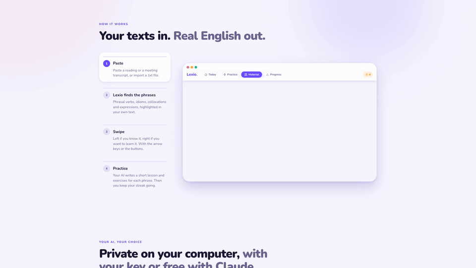

# Lexio · landing

Download page for [Lexio](https://github.com/juan-ramirez-dev/random-english-terms), a local-first desktop app that turns your readings and meeting transcripts into English practice. macOS and Windows.

**Live:** [juan-ramirez-dev.github.io/lexio-landing](https://juan-ramirez-dev.github.io/lexio-landing/) · in Spanish: [`?lang=es`](https://juan-ramirez-dev.github.io/lexio-landing/?lang=es)

[](assets/demo-en.mp4)

_How it works in four steps. [Full-quality MP4](assets/demo-en.mp4) (1080p, 22 s) · [En español](assets/demo-es.mp4)._

## What's on the page

- **English and Spanish.** EN/ES switch in the header. Phrases and sample texts stay in English: that's what Lexio teaches.
- **Hero** with a live swipe mock: cards go left (_I know it_) or right (_Learn it_).
- **How it works** (`#how`): the app's real flow in 4 clickable steps, with pause.
  - Paste a text → phrases highlighted by type → swipe → lesson + exercise.
- **Your AI:** local Qwen, your own OpenAI / Anthropic / Gemini key, or copy-paste with Claude.
- **Progress:** phrases moving from _New_ to _Mastered_, with the streak.
- **Contribute** (`#contribute`): fork → `pnpm desktop` → PR, plus first-contribution ideas.
- First-launch steps for unsigned builds.
- Download button picks macOS or Windows from the user agent.

## Tech stack

| Layer     | Tech                                                 |
| --------- | ---------------------------------------------------- |
| Page      | Plain HTML, CSS and JS. No build, no dependencies    |
| Languages | `i18n.js`: English base HTML + Spanish dictionary    |
| Design    | Same tokens as the app (copy of `globals.css`)       |
| Hosting   | GitHub Pages, deployed by GitHub Actions on `main`   |
| Downloads | Fixed-name assets on the app's latest GitHub Release |

## Engineering highlights

- **Mocks, not screenshots.** The swipe deck and the demo are HTML, so they stay sharp at any size and change with a text edit, in both languages.
- **Timeline as a pure function.** The demo is `render(t)`: pause, seek and step jumps just change `t`. CSS transitions do the smoothing.
- **No flash of the wrong language.** A tiny head script picks the language (`?lang=`, last choice, browser) and hides the page until `i18n.js` has translated it.
- **Cheap when idle.** Animations only run while visible and the tab is active.
- **Accessible by default.** Reduced motion turns each step into a still frame. Without JS the page is complete (in English). The mocks are `aria-hidden`; the steps tell the same story as text.
- **Release-proof links.** `releases/latest/download/Lexio-macos.dmg` and `Lexio-windows-setup.exe` never change between versions.

## Project notes

- Colors: tokens in the `<style>` of `index.html`. `styles.css` only uses `var(--token)`.
- Texts: English in `index.html` and `i18n.js`, Spanish in `i18n.js`. Every text has a `data-i18n*` key.
- Demo timings live in `main.js`. If the flow changes in the app, update them there and re-record.

## Recording the demo videos

```bash
node --experimental-websocket scripts/record-demo.mjs en   # assets/demo-en.mp4 + .gif
node --experimental-websocket scripts/record-demo.mjs es   # assets/demo-es.mp4 + .gif
```

- Needs Google Chrome and ffmpeg. No npm packages: it talks to Chrome over the DevTools protocol.
- `?record` stops the demo's own loop. The script seeks it frame by frame at 30 fps.
- Every CSS transition and animation is paused and moved by hand, so the video matches the live page on any machine.

## Run locally

Open `index.html` in a browser. Add `?lang=es` for Spanish.

## License

MIT
